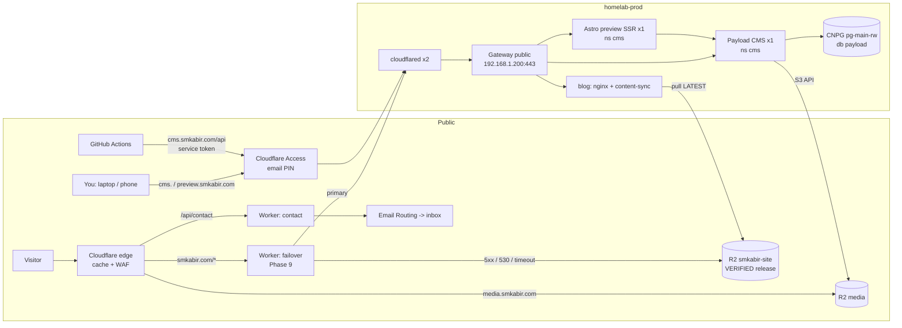
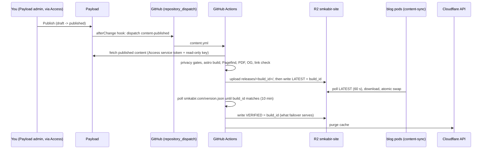

# smkabir.com — Blog, Resume & Site Plan

- [ ] Oct 6, 2026 · @mursalin kabir · reviewed and corrected Oct 6, 2026

## Review changes (2026-10-06)

Checked against the live `homelab-prod` cluster, `homelab-terraform`, DNS, and how
TraderBuddy is released. The corrections below are folded into the rest of this plan.

1. **Released the TraderBuddy way, from its own repo.** The site lives in a new repo,
   `smkabir-site`, that **builds images only**. It has no cluster access, no Argo CD
   knowledge, and no write access to `homelab-terraform`. A release is a `vX.Y.Z` tag
   that builds versioned GHCR images, plus a hand-made tag-bump commit in
   `homelab-terraform` under `prod/apps/blog/` and `prod/apps/cms/`. Rollback is
   `git revert` there. Every release gets a `CHANGELOG.md` entry.
   This replaces the old "CI commits a digest to GitOps with a deploy key" flow. That
   flow would have let a compromised blog pipeline push any manifest into the cluster.
2. **Content no longer ships as images.** Publishing in Payload builds `dist/` and
   uploads it to R2. The nginx pods pull the newest verified release from there. A new
   post therefore needs no GitOps commit, and the same R2 copy is the failover mirror.
   See *Build and CI/CD*.
3. **Tailscale is not part of this homelab.** It is not in the cluster, not on the Mac,
   and not in `homelab-terraform`. The admin is at `cms.smkabir.com`, behind **Cloudflare
   Access** (email PIN, as `argocd.smkabir.com` is today) and then Payload's own login. CI
   reads the Payload API with an Access **service token**, the same pattern the probe
   plan uses for `alerts.smkabir.com`. The Tailscale operator, the `tag:ci` ACL, and the
   Ingress-class exception are all gone.
4. **The GitOps paths are `prod/apps/<name>/` in `homelab-terraform`, as plain YAML.**
   - The `apps` ApplicationSet creates the namespace, labels it `restricted`, and sets
     the namespace on every object. So there are no `Namespace` objects, no
     `metadata.namespace`, and no kustomization.
   - That ApplicationSet also prunes and finalizer-deletes. Stateful objects (the CNPG
     `Database` and role) therefore go in `prod/data-platform/` (`prune: false`), next to
     `traderbuddy` and `zitadel`, and never in an app folder.
5. **The apex is already covered.** Certificate `smkabir-wildcard-tls` holds
   `smkabir.com` and `*.smkabir.com` (issuer `letsencrypt-dns01`). Gateway `public`
   already has an `https-apex` listener. The "add apex SAN" phase is removed. HTTPRoutes
   use `sectionName: https-apex` for the apex and `https-wildcard` for everything else.
6. **The control planes are meant to take workloads, but today they don't (config
   drift).**
   - Intended: `prod/talos/patch-common.yaml` sets `allowSchedulingOnControlPlanes:
     true` ("cp+worker collapsed").
   - Live (2026-10-06): `prod-1`, `prod-2` and `prod-3` still carry
     `node-role.kubernetes.io/control-plane:NoSchedule`. The rendered machine configs do
     not contain the setting, and no `.tf` references the patch, so it never reached
     the nodes. Every app pod (TraderBuddy included) runs on `prod-w1` (pve1, ~5.3 GiB
     allocatable).

   Fixing the drift is a **Phase 0 prerequisite**, done as its own Talos change in
   `homelab-terraform`: apply the patch, then confirm the taint is gone. Until then the
   spread rules stay soft. A hard spread would leave the second pod Pending, and "pods
   on two PVE hosts" cannot pass. Once fixed, the hard spread across
   `topology.homelab/pve-host` comes back. RAM is measured against the nodes that can
   actually schedule.
7. **Node labels already exist.** `topology.homelab/pve-host=pve1|pve2` were applied
   imperatively per `prod/data-platform/README.md`. The Talos `nodeLabels` change is
   removed.
8. **CNPG `pg-main` has no backups at all.** There is no `backup` spec and no
   `ScheduledBackup`, so TraderBuddy and Zitadel are not backed up either. This is a
   **prerequisite** done as its own `data-platform` change, not something Payload
   inherits.
9. **The pooler is in transaction mode.** `pg-main-pooler-rw` runs `poolMode:
   transaction`, which breaks Drizzle's prepared statements. Payload connects to
   `pg-main-rw` directly, like Zitadel.
10. **Secrets are SealedSecrets.** That pattern already exists (for example
    `prod/apps/traderbuddy/app.sealed.yaml`), so app secrets are committed sealed, never
    plain.
11. **The tunnel is remotely managed** (`k8s-homelab`). Hostnames are added under
    Cloudflare → tunnel → *Published application routes*, with service
    `https://cilium-gateway-public.gateway.svc.cluster.local:443` and Origin Server Name
    = the hostname. There is no cloudflared config file to edit.
12. **The failover drill goes through Git.** Argo CD self-heals a manual `kubectl
    scale` within seconds, so the drill commits `replicas: 0` in `homelab-terraform`
    and reverts it afterwards.
13. **Email Routing comes from the probe plan.** `homelab-terraform/plans/cloudflare-email-probe.md`
    enables it (the zone has no MX today), and its catch-all **drops** mail. So
    `hello@smkabir.com` must be added as a rule in that module before the contact form
    and resume address work.
14. **Phase numbers made consistent.** Cross-references said "phase 8 failover", "phase 6
    restore" and "measure in phase 6", while the list ran 0–10 and labelled item 1 as
    Phase 0. The phases are now headings, and every reference matches.

## Summary

A **headless Payload CMS** on the homelab (shared CNPG Postgres, media in R2, admin at
`cms.smkabir.com` **behind Cloudflare Access**) feeds a **static Astro** site at
`smkabir.com`. Publishing in Payload triggers a build. The built `dist/` goes to R2, and
**nginx-unprivileged** pods behind the existing Cilium Gateway and cloudflared serve the
newest verified release from there. Readers never touch Payload: if the CMS or its
database is down, the site keeps serving and only publishing stops.

The code that runs in the cluster (the nginx server image, Payload, the preview server)
is released exactly like TraderBuddy: tag → GHCR → tag bump in `homelab-terraform`.

**In scope (v1):**
- Blog (tech and Japan life), resume (HTML and PDF), Projects/Homelab, Now, Uses,
  Gallery, Contact, About, Search.
- English by default, with Bengali under `/bn/`.
- Editing in **Payload admin** (laptop or phone, through Cloudflare Access), with drafts
  and live preview.
- **Cloudflare Web Analytics** and **Pagefind** search.

**Out of scope (v1):** comments, newsletter, a Japanese locale, self-hosted analytics,
and staging-cluster deploys (added when `homelab-stg` exists).

**Challenge, stated once:** a static site on a single-house homelab is strictly less
available than Cloudflare Pages, for no reader benefit. The justification is dogfooding.
Because the resume is the page a recruiter opens, the R2 failover (Phase 9) is a
requirement, not polish.

### Assumptions — correct any that are wrong

| # | Assumption | If wrong |
| --- | --- | --- |
| A1 | Site on apex `smkabir.com`; `www` 301s to apex | Use `blog.smkabir.com`; only hostnames change |
| A2 | Apex is unused — **confirmed 2026-10-06:** no DNS records, no tunnel route | — |
| A3 | New GitHub repo `smkabir-site` (monorepo: site + CMS + Workers); images on GHCR. Content lives in Payload, so the repo can be public | Keep it private; nothing else changes |
| A4 | `homelab-terraform` + Argo CD manage `homelab-prod`; apps auto-discovered from `prod/apps/<name>/` | — (confirmed) |
| A5 | Bengali = UI strings + content you write in Bengali; no machine translation; resume English only | Localise the resume global later |
| A6 | Cloudflare Zero Trust team (`kabirlab`) already in use for Access; Payload is a new database on the shared CNPG cluster `pg-main` | Phase 0 checks the Access seat count and CNPG capacity |

## Decisions

Every choice keeps **state off the read path**. Payload and Postgres hold content, but
readers only ever hit static files (in-cluster or the R2 mirror) or Workers.

| Area | Decision | Why | Rejected |
| --- | --- | --- | --- |
| CMS | **Payload CMS 3.x**, headless, `@payloadcms/db-postgres` | Code-first TypeScript schema in the same monorepo; drafts, versions, localization and live preview built in; Postgres fits the shared-CNPG decision; generates types Astro consumes | Ghost (MySQL 8, renders pages itself → site dies with the homelab), Directus (weaker rich-text authoring), Strapi (heavier, fewer TS guarantees), WordPress |
| Admin access | `cms.smkabir.com` + `preview.smkabir.com` behind **Cloudflare Access** (email PIN for you; Service Auth for CI), then Payload login | Same perimeter as `argocd.smkabir.com`; no new infrastructure; phone and laptop just need a browser | Tailscale (not installed here), public login behind Zitadel only |
| Generator | Astro, static output (+ an SSR build of the same code for preview only) | Typed content, built-in i18n routing, image pipeline, JS islands only where needed | Next.js public frontend (SSR runtime on the read path), Hugo |
| Serving | `nginx-unprivileged` pod + a content-sync sidecar serving the current release from an `emptyDir` | Non-root on 8080, passes PodSecurity `restricted`, ~10 MB RSS; content changes without a rollout | Node SSR pod; baking content into the image |
| Code release | Tag `vX.Y.Z` → GHCR images by version → hand-made tag bump in `homelab-terraform`; rollback = `git revert` there | Identical to TraderBuddy; CI holds no cluster or GitOps credentials | CI deploy key to `homelab-terraform`, Argo CD Image Updater |
| Content release | Payload publish → `repository_dispatch` → CI builds `dist/` → uploads `releases/<build_id>/` to R2 → moves the `LATEST` pointer → pods pick it up → CI verifies → moves `VERIFIED` | A post is live in minutes with no GitOps commit; the R2 copy is the failover mirror | One image per post |
| Rebuild trigger | Payload `afterChange` hook on publish → GitHub `repository_dispatch` | Publishing is the only event that should rebuild; CI concurrency coalesces bursts | Polling, Payload-served pages |
| CI → CMS | `cms.smkabir.com/api/*` with an Access service token + a read-only Payload API key | Two independent credentials; no tailnet; no self-hosted runner | Self-hosted runners in the cluster, a public unauthenticated read API |
| Media | Payload Media collection → R2 via S3 storage adapter, served on `media.smkabir.com` | No binaries on cluster disks; never traverses the Tunnel; images work when the homelab is down | Local PVC uploads (node-pinned `local-path`) |
| URLs | `/posts/<slug>/`; category is metadata; slug shared across locales | URLs are a public API; recategorising never breaks a link | `/tech/<slug>/` |
| Contact | Worker + Turnstile + Email Routing `send_email` | No SMTP from a residential IP; no stored submissions | Payload form-builder (puts a public write endpoint on the homelab) |
| Analytics | Cloudflare Web Analytics | Cookieless, no consent banner, zero infra | Umami on CNPG |
| Search | Pagefind, build-time index | Fully static, separate index per `lang` | Algolia, Meilisearch |
| Routing | HTTPRoute on Gateway `public` (ns `gateway`): `sectionName: https-apex` for `smkabir.com`, `https-wildcard` for the rest | Existing listeners; matches TraderBuddy | Ingress resources, Traefik |
| `www` | 301 at Cloudflare edge (Redirect Rule) | One less route in cluster | HTTPRoute RequestRedirect |
| Secrets in Git | SealedSecrets (`*.sealed.yaml`) | Existing pattern in `homelab-terraform` | Plain Secrets applied by hand |

**What the full-CMS path costs you:**
- A stateful app plus a database to back up, migrate and upgrade.
- A Next.js runtime at roughly 300–600 MB RSS. Measure it; it is the first real RAM
  consumer this plan adds.
- A dependency chain (Payload → CNPG → etcd quorum on pve2) that gates *publishing*.

None of it gates *reading*.

## Architecture

The homelab serves HTML. Cloudflare serves everything that must survive the homelab
being down.

### Request path



Payload and the preview server have public hostnames, but **only behind Cloudflare
Access**. Until Phase 9, `smkabir.com` goes edge → tunnel directly.

**LAN bypass:** the Gateway's LAN IP `192.168.1.200` answers any `Host` header, so a
device on the home network can reach `cms.smkabir.com` without passing Access. Payload's
login is the wall there. Phase 4 also has Payload verify the `Cf-Access-Jwt-Assertion`
header against the team's certs (**verify** the current header name and JWKS URL), so
requests that skipped Access are rejected.

### Publish path



- A failed build never moves `LATEST`, so the previous release keeps serving.
- A release that never shows up in `version.json` never becomes `VERIFIED`, and CI
  fails loudly.
- Rolling back content means writing an earlier `build_id` to `LATEST` and `VERIFIED`.
  A manual workflow, `content-rollback.yml`, does this.

### Code release path (identical to TraderBuddy)

1. Change code in `smkabir-site`, update `CHANGELOG.md`, and push a `vX.Y.Z` tag.
2. `release.yml` builds `ghcr.io/<owner>/smkabir-site-server`, `smkabir-cms` and
   `smkabir-preview` at `X.Y.Z`, all `linux/amd64`. There is no `latest` tag, and a tag
   is never moved: a mistake ships as the next patch.
3. Wait until **all three** images exist on GHCR.
4. Bump the image pins in `homelab-terraform/prod/apps/blog/` and `prod/apps/cms/`,
   commit, push, and watch Argo CD reach Synced/Healthy.
5. To roll back, `git revert` the bump commit in `homelab-terraform`.

Astro template changes are **not** code releases. A merge to `main` under
`apps/site/**` rebuilds content through `content.yml`, because templates only change
`dist/`. The preview image follows tagged releases, so preview can lag `main` until the
next tag. That is acceptable.

## Routes and i18n

English lives at the root, and Bengali mirrors it under `/bn/`. i18n is scaffolded in
Phase 1, because retrofitting locale routing is a rewrite.

| Route | Content | Payload source | `/bn/` |
| --- | --- | --- | --- |
| `/` | Intro, latest 5 posts, featured projects | `home` global, `posts`, `projects` | yes |
| `/posts/`, `/posts/<slug>/` | All posts with category/tag filters; post page | `posts` | if published in `bn` |
| `/tech/`, `/japan/` | Category landing + category feed | `posts`, `categories` | yes |
| `/tags/<tag>/` | Tag listing | `posts`, `tags` | yes |
| `/projects/`, `/projects/<slug>/` | TraderBuddy, homelab build, others | `projects` | optional |
| `/resume/`, `/resume.pdf` | Resume HTML + generated PDF | `resume` global | no |
| `/now/` | Current focus, "updated" date | `now` global | optional |
| `/uses/` | Hardware, software, homelab kit | `uses` global | optional |
| `/gallery/`, `/gallery/<album>/` | Photo albums | `albums` → `media` | titles only |
| `/about/`, `/contact/`, `/search/` | Page, form, Pagefind UI | `pages`, component | yes |
| `/rss.xml`, `/tech/rss.xml`, `/japan/rss.xml`, `/bn/rss.xml` | Full-content feeds | `posts` | — |
| `/sitemap-index.xml`, `/robots.txt`, `/404.html`, `/version.json`, `/healthz` | Infra | build (`/healthz` from nginx) | — |

Not on the public site: the Payload admin (`cms.smkabir.com`) and the preview server
(`preview.smkabir.com`), both behind Cloudflare Access.

### i18n rules

- Astro: `defaultLocale: 'en'`, `locales: ['en','bn']`, no prefix for `en`. **Verify
  the exact config keys** for the pinned version.
- Payload: `localization: { locales: ['en','bn'], defaultLocale: 'en', fallback: false }`.
  - Text fields (`title`, `description`, `content`, alt text) are `localized: true`.
  - `slug`, `pubDate`, `category`, `tags` and `hero` are shared.
  - One document = one post in both languages, so translation linking is free.
- Per-locale visibility uses a localized checkbox `publishedIn`, or Payload's per-locale
  draft status if the pinned 3.x version supports it (**verify**). The Astro build emits
  `/bn/posts/<slug>/` only when `bn` is enabled for that post.
- `fallback: false` is deliberate: a missing Bengali field must produce no page, not an
  English page under a Bengali URL.
- UI strings live in `src/i18n/{en,bn}.json`, typed. A missing `bn` key **fails the
  build**.
- `/bn/` listings show Bengali posts only, plus a link to the English index. The
  language switcher shows only when the counterpart exists.
- `<html lang>` is set per page; Pagefind index splitting, hreflang and screen readers
  depend on it.
- Dates use `Intl.DateTimeFormat('bn-BD')`. Code blocks are left untouched.
- Fonts are **self-hosted**:
  - A Latin text face, a mono, and **Noto Sans Bengali** (or Hind Siliguri), subset to
    woff2 with `unicode-range`.
  - Body `line-height ≥ 1.7` for Bengali; tighter leading clips conjuncts and vowel
    signs.
  - Apply the same font to the Payload admin's rich-text editor, so drafts look right
    while writing.
- An inline `Jp` block in the editor (fields `t`, `r`, `en`) renders `本免許 (honmenkyo)`
  with the English gloss on hover or tap.

## Content model

The schema lives in code at `apps/cms/src/collections/` and `globals/`.
`payload generate:types` emits `payload-types.ts`, which Astro imports, so a schema
change that breaks the site fails `astro check`. Illustrative shapes:

```ts
// collections (versions + drafts enabled on posts, projects, pages, albums)
posts: {
  title*, description* (<= 160),        // * = localized
  slug (unique, immutable after first publish),
  pubDate, updatedDate?,
  category -> categories ('tech' | 'japan-life'),
  tags -> tags[],
  hero -> media?,                     // alt is required on media itself
  series?: { name, part },
  toc: boolean = true,
  content*: lexical richText with blocks (below),
  publishedIn*: boolean,              // per-locale visibility
}
projects: { title*, summary*, status, stack[], repo?, links[]?, featured, order, hero?, content* }
pages:    { title*, slug, content* }               // about, contact intro
albums:   { title*, date, region?, cover -> media, photos -> media[] (ordered), captions* }
media:    { alt* (required), caption*?, credit? }  // upload collection, sizes below
categories, tags: { name*, slug }
users:    admin only, no public registration

// globals
resume:   JSON-Resume-shaped groups (basics, work[], education[], skills[], projects[],
          languages[], certificates[]); English only
home, now (updated date), uses (groups -> items), site (nav, socials, footer)
```

Media upload: `imageSizes` at 480 / 960 / 1600 / 2400 w, AVIF and WebP, `focalPoint`
on. Astro uses the stored sizes directly, with no second image pipeline at build.

### Rich-text blocks (Lexical)

- Astro renders the Lexical JSON with its own serializer, mapping each node and block to
  an Astro component. It does not use Payload's HTML converter, so styling and islands
  stay in the site.
- **Code** block: `language`, `filename?`, `code`, `highlightLines?`. Rendered by
  Expressive Code (titles, diff, copy button, terminal frame).
- **Diagram** block: `kind: d2 | mermaid`, `source`. Rendered to SVG at build (the `d2`
  binary and Playwright run in CI). The admin shows the source only; the preview server
  renders it.
- **Callout** (note / warn / danger), **Figure** (media + caption + credit),
  **Terminal** (command + output; copy copies the command only), **Gallery strip**
  (media\[\]).
- Inline **Jp** block (`t`, `r`, `en`).
- Paste-from-Markdown in the editor, for drafting tech posts in your own editor first.
  **Verify** that the pinned Lexical feature set supports it; if not, add a
  Markdown-import field or action.

### Build-time validation

- The build fetches **published** versions only (`draft=false`). CI asserts that no
  draft-only slug appears in `dist/`.
- Payload validation: `media.alt` is required; `slug` matches `^[a-z0-9-]+$` and is
  read-only once published.
- Published URLs are permanent. CI keeps the previous release's URL list (from R2) and
  fails when a URL disappears without an entry in the `redirects` collection. Redirects
  are emitted as `dist/_redirects.json`, which the content-sync sidecar renders into an
  nginx `map` include. They cannot be baked into the image, because content is not in
  the image.
- A build against an empty or unreachable CMS **fails**. Never ship a site with zero
  posts because Access or the tunnel hiccupped.

## Payload CMS and authoring

You write in Payload admin through Cloudflare Access. **Save** keeps a draft, and
**Publish** rebuilds the public site (typically a few minutes end to end; measure it in
Phase 7).

### Editing flow

1. Open `https://cms.smkabir.com/admin` on a laptop or phone. Cloudflare Access asks for
   the email PIN, then Payload asks for its own login.
2. Draft with autosave. Versions are kept, so any publish can be reverted.
3. The **live preview** pane points at
   `https://preview.smkabir.com/preview/posts/<slug>?locale=…`. That is the same Astro
   code built with an SSR adapter, reading drafts with a preview-only API key over the
   in-cluster Service. It renders D2/Mermaid, code blocks and Bengali exactly as
   production will. Put `cms` and `preview` in **one** Access application, so one PIN
   covers both and the preview iframe is not blocked (**verify** how Access handles a
   cross-hostname iframe; if needed, serve preview under `cms.smkabir.com/preview/`).
4. Publish fires the `afterChange` hook only on a transition to `published`, or on an
   edit to a published doc. It sends a `repository_dispatch` of type
   `content-published`. A custom admin button, "Rebuild site", fires the same dispatch
   for global edits and retries.
5. CI posts the build status back as a Payload notification or a Slack message (you
   already use Slack for TraderBuddy alerts).

### Payload runtime

- **Payload 3.x** runs inside Next.js. One Deployment, `replicas: 1`, `strategy:
  Recreate`; it is admin-only, so a minute of downtime during a rollout is fine.
  - Requests 256Mi and limit 768Mi until measured.
  - Until the Talos drift is fixed it lands on `prod-w1`, next to all of TraderBuddy.
- **Database:** a new database and role `payload` on `pg-main`, declared in
  `prod/data-platform/`:
  - the `managed.roles` entry in `03-cnpg-cluster.yaml`;
  - the sealed password in `04-postgres-app-roles.sealed.yaml`;
  - a `Database` with `databaseReclaimPolicy: retain` in `05-cnpg-databases.yaml`.

  Connect to **`pg-main-rw` directly**, like Zitadel. `pg-main-pooler-rw` is in
  `transaction` mode, which breaks Drizzle's prepared statements.
- **Migrations:** `payload migrate:create` in dev, committed to git. Production runs
  `payload migrate` as an Argo CD **PreSync hook Job**. Never use schema `push` mode in
  production.
- **Secrets** (`PAYLOAD_SECRET`, DB password, R2 keys, GitHub dispatch token, preview API
  key, Access team audience tag): **SealedSecrets** in `prod/apps/cms/*.sealed.yaml`,
  like TraderBuddy's `app.sealed.yaml`. The DB password goes in `data-platform`'s sealed
  roles file.
- **Users:** admin users only, with `auth.maxLoginAttempts` and `lockTime` set, no
  public registration, and `graphQL` disabled if unused. Cloudflare Access is the
  perimeter; Payload auth is the second wall, not the first. Also verify the Access JWT
  (see *LAN bypass*).
- A read-only **builder** API key (CI) and a **preview** API key (preview server), as
  separate users with read-only access control.
- **GitHub token for dispatch:** a fine-grained PAT scoped to the `smkabir-site` repo
  only, with the minimum permission `repository_dispatch` needs (**verify**; believed to
  be Contents: write). Rotate it yearly.

### Privacy guardrails — Japan-life content is where leaks happen

- **EXIF/GPS on originals.** Payload stores the uploaded original next to the resized
  sizes, and sharp strips metadata from the sizes but **not** from the original. A
  `beforeOperation`/`beforeChange` hook on `media` re-encodes the original with sharp
  (auto-rotate, then write without metadata) before storage.
  Test: upload a GPS-tagged fixture, download the stored original from R2, and confirm
  `exiftool` shows no GPS.
- Serve only the generated sizes publicly. The original's URL is never emitted by the
  site.
- **HEIC:** iPhone uploads may be HEIC, and sharp's prebuilt libvips may not decode it
  (**verify**). Fallback: reject HEIC with a clear admin error, and set the phone camera
  to "Most Compatible" (JPEG).
- **Denylist scan** in CI over the fetched content and the built HTML, using the secret
  `PRIVACY_DENYLIST` (address fragments, phone, personal email). It is kept in a GitHub
  secret so the list does not publish what it protects. A hit fails the build and names
  the post.
- **Photo checklist** as admin description text on `media`: house exterior, street and
  station signs, car number plate ナンバープレート (nanbā purēto), nameplate 表札
  (hyōsatsu), reflections, faces of family members.
- **Location granularity:** the home area at city level at most. Trip venues are fine
  once you have left.

## Resume

One `resume` global drives both `/resume/` and `/resume.pdf`. The PDF is printed by
Chromium in CI, so the two can never drift.

- The global's fields follow the **JSON Resume** groups (basics, work, education, skills,
  projects, languages, certificates), so an export endpoint can emit a valid
  `resume.json` for other tools.
- `/resume/`: semantic HTML, a print stylesheet, and "Updated \<date>" from the global's
  `updatedAt`.
- `/resume.pdf`: Playwright prints `/resume/print/` at **A4** with 15 mm margins,
  selectable text and embedded fonts. Response header `X-Robots-Tag: noindex`, so search
  results land on the HTML page.
- **Contact on the resume:** `hello@smkabir.com` (an Email Routing rule, which must be
  added to the probe plan's `cloudflare/email-routing/` module) and a link to
  `/contact/`. **Never** a phone number, home address or personal Gmail; the denylist
  scan enforces it.
- **Languages:** list spoken and reading ability separately for Japanese. Japanese
  employers will test exactly that line.
- JSON-LD `Person` + `ProfilePage`; `rel="me"` links to GitHub and LinkedIn.
- Later, not v1: a 職務経歴書 (shokumu keirekisho) variant from the same global. It
  needs a `ja` locale on this one global only.
- The resume is the page that must not 530. It is the first URL in the Phase 9 failover
  drill.

## Gallery and media

All media goes to one R2 bucket through Payload. The public reads it from
`media.smkabir.com`, never through the Tunnel.

- Bucket `smkabir-media`, using Payload's S3 storage adapter (`@payloadcms/storage-s3`)
  with the R2 S3 endpoint. **Verify** the adapter's R2 compatibility notes; checksum
  headers have broken some S3 clients against R2.
- A public custom domain `media.smkabir.com` on the bucket, with a Cache Rule edge TTL
  of 1 year. Object keys carry a content hash or upload ID, so URLs are immutable and
  replacing an image creates a new key.
- **Albums:** create in admin, **bulk upload** into `media`, and order and caption
  there. No ingest script.
- **Gallery UI:** a justified grid, `<picture>` with the stored AVIF/WebP sizes,
  LQIP/blurhash stored on the media doc at upload, a lightbox island (PhotoSwipe), and
  lazy loading.
- **R2 is a CDN, not a backup.** Originals stay in your photo library and in
  `PersonalMediaBackup` on qdev-pbs. The bucket itself is backed up nightly (see
  *State and backups*), because Payload's media rows point into it.
- **Bandwidth:** R2 egress is free and the storage free tier is 10 GB (**verify current
  pricing**). The site bucket keeps only the last 20 releases (CI prunes the older
  ones), so a gallery of resized images plus releases stays well under the limit.

## Contact form

A Worker on `smkabir.com/api/contact` validates submissions and mails them to you.
Nothing is stored, and it works with the homelab down.

1. **Form:** name, email, message, a hidden honeypot field and a Turnstile widget. It is
   a same-origin POST, so there is no CORS and CSP `form-action 'self'` holds.
2. **Worker checks:** method is POST, honeypot is empty, the Turnstile token passes
   siteverify, the message is ≤ 5,000 chars, and the email is syntactically valid.
3. **Rate limit** per IP (Workers Rate Limiting binding; **verify availability on your
   plan**), plus a Cloudflare WAF rate-limiting rule on the path as a backstop.
4. **Send** via the Email Routing `send_email` binding to your verified destination
   address: plain-text body, `Reply-To` = the submitter, and a fixed subject prefix.
   User input never goes into headers unescaped.
5. **Respond** with a 303 to `/contact/thanks/` (works without JS, apart from the
   Turnstile challenge), or JSON when called via `fetch`.

**Prerequisite:** Email Routing, from `homelab-terraform/plans/cloudflare-email-probe.md`
Phase 2, with a `hello@smkabir.com` rule added to that module (its catch-all drops
everything else) and verified before Phase 8. The code lives in `workers/contact/` and
is deployed by `workers.yml` on a version tag (see *Build and CI/CD*).

## Search, analytics, SEO

All of it is generated at build time; nothing runs per request.

- **Pagefind** runs over `dist/` after `astro build`.
  - `data-pagefind-body` goes on the article only, which excludes nav and footer.
  - Filters for category, tags and language, with a separate index per `<html lang>`.
  - **Verify** how Pagefind segments Bengali. Whitespace tokenisation is acceptable;
    stemming is likely absent.
- **Cloudflare Web Analytics** via the manual beacon snippet (not auto-injection), so
  the CSP lists it explicitly. Expect ad-blocker undercount; zone analytics shows the
  true request volume.
- **SEO:** canonical URLs, OG/Twitter meta, JSON-LD `BlogPosting` per post, `Person` on
  about and resume, a sitemap with hreflang alternates, and `robots.txt`.
- **OG images:** rendered by Playwright Chromium from an `/og/<slug>/` HTML template.
  Do **not** use satori for these; it lacks complex-script shaping and mangles Bengali
  conjuncts.
- **Feeds:** full-content RSS per language and per category. Tech readers rarely want
  Japan-life posts, and the reverse.
- **Performance budget** (Lighthouse CI on home, a code-heavy post and a gallery):
  performance ≥ 95, accessibility = 100, CLS < 0.05, and JS on post pages ≤ 30 KB
  gzipped (search and theme-toggle islands only).

## Build and CI/CD

The `smkabir-site` repo builds and uploads; it **never** holds cluster or
`homelab-terraform` credentials. Four workflows:

| Workflow | Trigger | Output |
| --- | --- | --- |
| `content.yml` | push to `main` under `apps/site/**`; `repository_dispatch: content-published`; manual | `dist/` → R2 `smkabir-site/releases/<build_id>/`, `LATEST`, verify, `VERIFIED`, cache purge |
| `release.yml` | tag `v*.*.*` | `smkabir-site-server`, `smkabir-cms`, `smkabir-preview` images at `X.Y.Z` on GHCR. **Deployment is the hand-made bump in `homelab-terraform`**, as with TraderBuddy |
| `workers.yml` | tag `v*.*.*` (changed Workers only) | `wrangler deploy` for `workers/contact`, `workers/failover` |
| `content-rollback.yml` | manual, input `build_id` | rewrites `LATEST` and `VERIFIED` to an earlier release |

Workers are deployed by CI because they are not cluster workloads, so no GitOps object
pins them. They still ship only from a tag with a `CHANGELOG.md` entry, and rollback is
the previous tag's `wrangler deploy` (or `wrangler rollback`; **verify**).

### `content.yml` jobs (illustrative)

```text
verify   pnpm install --frozen-lockfile; astro check (uses payload-types.ts); eslint; prettier --check
build    fetch published content from https://cms.smkabir.com/api with
           CF-Access-Client-Id/Secret headers + builder API key -> fail if unreachable or zero posts
         privacy gates: denylist over content JSON
         astro build -> pagefind --site dist -> playwright: resume.pdf + OG images
         denylist over dist/; lychee link check (internal hard-fail, external warn)
         URL-diff vs the VERIFIED release's url list in R2 -> fail on removed URL without redirect
         write dist/version.json {build_id: <sha>-<run_id>, builtAt}
publish  upload dist/ -> r2://smkabir-site/releases/<build_id>/ ; then write LATEST = <build_id>
         poll https://smkabir.com/version.json until build_id matches (10 min timeout)
         write VERIFIED = <build_id>; purge Cloudflare cache; prune releases beyond the last 20
```

- `build_id` includes the run ID, because content-only rebuilds share the same git SHA.
- **Concurrency:** `verify`/`build` run in group `site-build` with `cancel-in-progress:
  true`, so five quick publishes become one build. `publish` runs in group
  `site-publish` with `cancel-in-progress: false`, so a pointer update is never cut in
  half.
- Actions are pinned by commit SHA. Renovate covers npm, actions, base images and
  Payload.
- **Secrets:**
  - `CF_ACCESS_CLIENT_ID` and `CF_ACCESS_CLIENT_SECRET`: the CI service token, allowed
    only by the `cms` Access app's Service Auth policy.
  - `PAYLOAD_BUILDER_KEY`: read-only.
  - `R2_SITE_WRITE_*`: write on `smkabir-site` only.
  - `CF_API_TOKEN`: cache purge + Workers deploy.
  - `PRIVACY_DENYLIST`.

  No cluster credentials and no `homelab-terraform` write access anywhere in GitHub.
- **GHCR:** the `smkabir-site-server` image is **public** (nginx + config, no content).
  The `smkabir-cms` and `smkabir-preview` images are **private**, with an
  imagePullSecret (sealed) in ns `cms`, because they contain admin code and config.
- **Images:** built `linux/amd64` explicitly (the nodes are Intel N100s), with trivy
  failing the build on fixable HIGH/CRITICAL.

### Site server image

```dockerfile
# illustrative — no content in the image; the content-sync sidecar fills /srv/site
FROM nginxinc/nginx-unprivileged:<pinned>-alpine
COPY nginx/default.conf /etc/nginx/conf.d/default.conf
```

The nginx config must set:
- `root /srv/site/current;`, a symlink the sidecar swaps atomically.
- `absolute_redirect off; port_in_redirect off;`. Otherwise directory redirects leak
  `:8080` through the tunnel.
- `try_files $uri $uri/ $uri.html =404` and `error_page 404 /404.html`.
- Temp paths and the pid under `/tmp`.
- `include /srv/site/current/_redirects.conf;`, generated by the sidecar.
- `Cache-Control: public, max-age=31536000, immutable` on `/_astro/*`.
- HTML `public, max-age=0, s-maxage=86400` (purged on publish).
- `no-store` on `version.json` and `/healthz`.
- `server_tokens off`.

`/healthz` is answered by nginx itself (`return 200`) for liveness. Readiness checks
that `/srv/site/current/version.json` exists, so a fresh pod takes no traffic until it
has content.

**Content-sync sidecar** (a native sidecar, `initContainers` with `restartPolicy:
Always`):
- Polls `smkabir-site/LATEST` every 60 s with a read-only R2 token.
- Downloads `releases/<id>/` to `/srv/site/<id>` and swaps the `current` symlink.
- Keeps the previous release, and deletes older ones.

It runs non-root with a read-only root filesystem (rclone or a ~50-line Go/Node
script; **verify** that the chosen image runs under `restricted`). If R2 is unreachable,
running pods keep serving what they have. A pod rescheduled during an R2 outage stays
unready, and the failover Worker covers it.

## Kubernetes on homelab-prod

Two app folders in `homelab-terraform`, each a namespace created by the `apps`
ApplicationSet and labelled `restricted`:
- `blog`: public and stateless.
- `cms`: behind Access. Its database lives in `data-platform`, not here.

All manifests are plain YAML. They set no `metadata.namespace` and contain no
`Namespace` objects.

### `prod/apps/blog/` — public site

| Object | Spec |
| --- | --- |
| Deployment `blog` | 2 replicas, image `smkabir-site-server:X.Y.Z` + content-sync sidecar, port 8080; `runAsNonRoot`, uid 101 (sidecar: its own non-root uid), `readOnlyRootFilesystem`, `allowPrivilegeEscalation: false`, drop ALL caps, `seccompProfile: RuntimeDefault`; `emptyDir` on `/tmp` and `/srv/site`; requests 10m / 32Mi (+ sidecar), limit 128Mi memory, no CPU limit; liveness `/healthz`, readiness as above; `automountServiceAccountToken: false` |
| Spread | `topologySpreadConstraints` on `topology.homelab/pve-host` and `kubernetes.io/hostname`. **`DoNotSchedule` once the Talos drift is fixed** (four schedulable nodes across pve1/pve2); `ScheduleAnyway` until then, because today only `prod-w1` is schedulable and a hard spread would leave replica 2 Pending. Prefer nodes other than `prod-1` (the smallest, ~3.2 GiB allocatable) |
| PDB | `minAvailable: 1` |
| Service | ClusterIP 80 → 8080 |
| HTTPRoute | parentRef Gateway `public` / ns `gateway`, `sectionName: https-apex`, hostname `smkabir.com`, path `/` → Service `blog` |
| SealedSecret | read-only R2 token for `smkabir-site` |
| NetworkPolicy | ingress only from the Gateway's Envoy identity (**verify** the identity/selector for Cilium 1.20 Gateway API); egress: kube-dns + the R2 S3 endpoint on 443 via `toFQDNs`, nothing else |

**Tunnel route** (Cloudflare dashboard, `k8s-homelab` → Published application routes):
hostname `smkabir.com`, service
`https://cilium-gateway-public.gateway.svc.cluster.local:443`, Origin Server Name
`smkabir.com`. **Verify** that a published route on the zone apex creates the flattened
CNAME the way it does for subdomains.

### `prod/apps/cms/` — Payload + preview

| Object | Spec |
| --- | --- |
| Deployment `payload` | image `smkabir-cms:X.Y.Z`, 1 replica, `Recreate`, requests 256Mi, limit 768Mi until measured; must meet `restricted` (the ApplicationSet enforces it, and there is no `baseline` fallback inside `prod/apps/`): non-root, read-only root FS, writable `/tmp` and `.next/cache` emptyDirs |
| PreSync Job | `payload migrate` with the same image; sync fails if the migration fails |
| Deployment `preview` | image `smkabir-preview:X.Y.Z` (Astro SSR build of `apps/site`), 1 replica, ~128Mi |
| Services + HTTPRoutes | `cms.smkabir.com` → `payload`, `preview.smkabir.com` → `preview`, both `sectionName: https-wildcard` |
| SealedSecrets | `PAYLOAD_SECRET`, DB password ref, R2 media keys, GitHub dispatch PAT, preview API key, Access audience tag, GHCR pull secret |
| NetworkPolicy | ingress only from the Gateway (and `preview` → `payload`); egress: kube-dns, `pg-main-rw` 5432 in ns `platform`, and via Cilium `toFQDNs` to `api.github.com`, the R2 S3 endpoint and `<team>.cloudflareaccess.com` (JWKS) on 443 |

**Outside the app folder:**
- **Database** (in `prod/data-platform/`, `prune: false`): the `payload` role, its
  sealed password, and a `Database` with `databaseReclaimPolicy: retain`.
- **Cloudflare Access application** "cms" covering `cms.smkabir.com` and
  `preview.smkabir.com`, with two policies:
  - Allow: emails = yours (one-time PIN).
  - Service Auth: the CI service token.

  Create it **before** the tunnel routes, so the hostnames are never publicly open.

### State and backups (new with the full-CMS path)

| State | Lives in | Backup | Restore test |
| --- | --- | --- | --- |
| Content, users, versions | CNPG `pg-main`, database `payload` | **Prerequisite, not yet existing:** `pg-main` has no backup today (nor do TraderBuddy and Zitadel). Add a `ScheduledBackup` + WAL archiving to R2 bucket `smkabir-pg-backups` (Barman Cloud plugin; **verify** the current CNPG 1.30 method) as its own `data-platform` change | Phase 4 gate: restore to a scratch `Cluster`, point a throwaway Payload at it |
| Media | R2 `smkabir-media` | Nightly `rclone sync` to qdev-pbs `/mnt/usbhdd/Backup/r2-media`, from a **systemd timer on qdev-pbs**, run as a `users`-group account (never `chown -R` that disk) | Spot-check object count + one image |
| Site releases | R2 `smkabir-site` (last 20) | Rebuildable from Payload + git | — |
| Code, schema, migrations | GitHub | git | — |

A PBS snapshot of a VM running a Postgres member is crash-consistent at best. It is not
the database backup.

**RAM:** Payload plus preview add roughly 0.5–0.9 GB of requests. Allocatable memory is
about `prod-w1` 5.3, `prod-2`/`prod-3` 4.2 and `prod-1` 3.2 GiB. Today, because of the
taint drift, all of it lands on `prod-w1` next to all of TraderBuddy. Measure after
Phase 4 and record it. This competes directly with the open "free RAM" gap, and fixing
the drift is what gives it room.

## Resilience: R2 failover

When the tunnel has no healthy connectors, Cloudflare returns 530 / error 1033, and edge
cache only helps on POPs that happen to be warm. A Worker in front of the site serves
the `VERIFIED` release from R2 instead.

```js
// illustrative — workers/failover
export default {
  async fetch(req, env) {
    if (req.method !== 'GET' && req.method !== 'HEAD') return fetch(req);
    try {
      const res = await fetch(req, { signal: AbortSignal.timeout(4000) });
      if (res.status < 500) return res;          // 530 from a dead tunnel falls through
    } catch (_) {}
    return serveFromMirror(req, env.SITE_BUCKET); // reads VERIFIED, then releases/<id>/…:
  },                                              // /x/ -> x/index.html, 404 -> 404.html,
};                                                // same security headers, X-Served-From: mirror
```

- The mirror is the `VERIFIED` pointer: the release CI saw live on the origin. Failover
  never serves an unverified build, and it is the same bucket the pods read, so there is
  no second sync.
- `/api/contact` is handled by the contact Worker on a more specific route (**verify**
  Workers route precedence). `media.smkabir.com` never touches the homelab anyway.
- Responses from the mirror carry `X-Served-From: mirror`. The Worker-cron uptime probe
  (`homelab-terraform/plans/cloudflare-email-probe.md`) adds `smkabir.com/version.json`
  and `/resume/` to its targets, and alerts when the header appears or the origin times
  out.
- **Cost:** the Worker runs on every request to `smkabir.com`. Free-plan daily request
  limits are far above a personal blog's traffic (**verify current limits**).
- **What still fails when the homelab is down:** publishing (Payload unreachable) and
  preview. Reading, the resume, the gallery, contact and search all keep working.

**Drill (weekend):**
1. In `homelab-terraform`, commit `replicas: 0` on `blog`. Argo CD self-heals a manual
   `kubectl scale` within seconds, so the drill must go through Git.
2. Check `/`, `/resume/`, `/resume.pdf`, a gallery album, search and contact. Confirm the
   mirror header and the probe alert.
3. `git revert` the change.

Add this to the failure-drill list in the k8s runbook.

## Security

Headers come from one source file (`apps/site/security-headers.json`), rendered into
both the nginx config and the failover Worker, so mirror responses match the origin.

```text
Content-Security-Policy: default-src 'self'; script-src 'self' https://static.cloudflareinsights.com https://challenges.cloudflare.com;
  connect-src 'self' https://cloudflareinsights.com; img-src 'self' https://media.smkabir.com data:;
  frame-src https://challenges.cloudflare.com; style-src 'self' 'unsafe-inline'; font-src 'self';
  form-action 'self'; frame-ancestors 'none'; base-uri 'self'; object-src 'none'
X-Content-Type-Options: nosniff
Referrer-Policy: strict-origin-when-cross-origin
Permissions-Policy: camera=(), microphone=(), geolocation=()
Strict-Transport-Security: set at Cloudflare edge
```

- **No inline scripts** on the public site. If Astro emits any, use its CSP hash support
  (**verify** its status in the pinned version) rather than `'unsafe-inline'` for
  scripts.
- **HSTS `includeSubDomains`:** `pve1`, `pve2` and `qdev-pbs.smkabir.com` resolve to LAN
  IPs and are HTTPS-only already, but confirm every `*.smkabir.com` name before enabling
  it.
- **Cloudflare:** WAF managed rules on, a rate-limit rule on `/api/contact`, and SSL mode
  Full (strict).
- **Payload attack surface:**
  - Cloudflare Access in front.
  - The Access JWT verified by Payload, which closes the LAN bypass.
  - Payload's login lockout.
  - Renovate keeps Payload and Next.js current. Next.js advisories land often, and
    patching is the actual control even behind Access.
- **Tokens** are least-privilege and listed in one table in `docs/secrets.md` (name,
  scope, where stored, rotation date), with no values.
- **Cluster side:** both namespaces have a default-deny NetworkPolicy, no SA token
  mount, images by version tag (as TraderBuddy), and a read-only root FS.

## Phases and gates

Claude Code works one phase at a time and stops at each gate with command output.
Nothing touches `homelab-prod` before Phase 4. Cluster changes are always a commit to
`homelab-terraform`; the `smkabir-site` repo never changes the cluster.

### Phase 0 — Prechecks (no code)

Already confirmed on 2026-10-06; re-check only what may have changed:

| Fact | Value |
| --- | --- |
| Apex `smkabir.com` | no DNS records, no tunnel route |
| Gateway `public` | listeners `https-apex` (`smkabir.com`) and `https-wildcard` (`*.smkabir.com`), `allowedRoutes: All` |
| Certificate | `smkabir-wildcard-tls` = `smkabir.com` + `*.smkabir.com`, issuer `letsencrypt-dns01` |
| Tunnel | `k8s-homelab`, remotely managed |
| Schedulable nodes | intended: all four (`allowSchedulingOnControlPlanes: true` in `patch-common.yaml`); **live: `prod-w1` only** — `prod-1..3` still tainted (drift) |
| CNPG | `pg-main` (ns `platform`), 3/3, **no backups**; pooler `pg-main-pooler-rw` in `transaction` mode |
| Access | in use (`argocd.smkabir.com` → `kabirlab.cloudflareaccess.com`) |
| Tailscale | not used |
| Email Routing | not enabled yet (no MX); comes from the probe plan |

Still to do:
- Fix the Talos drift: get `allowSchedulingOnControlPlanes` into the applied config so
  `prod-1..3` lose the `NoSchedule` taint. **Verify** how Talos v1.14 applies it (it may
  need the patch wired into the Terraform machine-config resources, and a config apply
  per node). This is its own change, with MK present.
- Create R2 buckets `smkabir-media`, `smkabir-site` and `smkabir-pg-backups`.
- Land the CNPG backup change in `data-platform`.
- Land the Email Routing module with a `hello@` rule.

**Gate:** `docs/phase0.md` answers every item with pasted output.

### Phase 1 — Repo and site skeleton

> **Superseded by `docs/design.md` (2026-10-08):** the light/dark theme and the theme-toggle island described in this
> phase and in the performance budget were dropped. The site is light only, and post-page JavaScript is the
> menu, copy-link and Japanese-gloss scripts (about 4 KB gzip), well under the 30 KB budget.

- Create the new GitHub repo `smkabir-site`: a pnpm workspace (`apps/site`, `apps/cms`,
  `workers/*`), `CHANGELOG.md` and `CLAUDE.md`.
- Astro with a base layout, light/dark theme, EN/BN routing, string tables, self-hosted
  fonts and a 404, built against **fixture JSON** shaped like future Payload responses.

**Gate:** `astro check` is clean; `/` and `/bn/` carry the right `lang`; a Bengali
conjunct test page renders correctly; Lighthouse accessibility is 100.

### Phase 2 — Payload locally

Docker Compose Postgres; collections, globals and localization; media to an R2 dev
bucket; the EXIF-stripping hook; admin users; migrations committed; `payload-types.ts`
generated and consumed by the site.

**Gate:**
- A GPS-tagged fixture uploads, and the stored original has no GPS (`exiftool`).
- A missing BN-only field produces no BN page in a fixture build.
- Migrations apply on an empty DB.

### Phase 3 — Site on Payload

The Lexical → Astro renderer with all blocks; posts, categories, tags, projects, pages,
gallery, now and uses; resume HTML + PDF; OG via Playwright; Pagefind; feeds; sitemap;
the privacy denylist; the URL-diff check.

**Gate:**
- Three sample posts build from local Payload: an EN tech post with code + D2, an EN
  Japan-life post with photos, and a BN post.
- Drafts are absent from `dist/`.
- The resume PDF is A4 with selectable text, and the denylist is clean.

### Phase 4 — Payload into the cluster

- The `payload` role and database in `prod/data-platform/`, and the Access application
  "cms".
- The first `v0.1.0` tag, with `smkabir-cms` and `smkabir-preview` images.
- `prod/apps/cms/`: Deployments, the PreSync migration Job, HTTPRoutes,
  NetworkPolicies, SealedSecrets. Tunnel routes for `cms` and `preview` come last.

**Gate:**
- The admin is reachable from the phone through Access, and returns an Access login,
  not Payload, from an incognito browser.
- A request to the Gateway IP with `Host: cms.smkabir.com` and no Access JWT is
  rejected.
- A DB restore to a scratch cluster succeeds.
- The media rclone to qdev-pbs runs once.
- RAM on `prod-w1` is measured and recorded.

### Phase 5 — Site pipeline and first deploy on `next.smkabir.com`

- `content.yml` (R2 upload and pointers) and `release.yml`.
- The `smkabir-site-server` image with the content-sync sidecar.
- `prod/apps/blog/`, with the HTTPRoute temporarily on `next.smkabir.com`
  (`https-wildcard`) and a tunnel route for `next`.

**Gate:**
- `next.smkabir.com/version.json` matches `LATEST`.
- With the drift fixed, the two `blog` pods are on different PVE hosts.
- A new publish appears without any `homelab-terraform` commit.
- Deleting one pod under a request loop drops zero requests.
- PSA `restricted` is admitted for both containers.
- The header check passes.

### Phase 6 — Apex cutover

Switch the HTTPRoute to `smkabir.com` (`https-apex`), add the tunnel route for the
apex, add the `www` edge redirect, and retire `next`. The certificate already covers
the apex, so there is no ACME change.

**Gate:** the apex serves with the valid existing certificate; `www` 301s to the apex;
Full (strict) holds.

### Phase 7 — Publish loop and live preview

The `afterChange` dispatch hook, the "Rebuild site" button, the preview server with
Payload live preview, and the build-status notification.

**Gate:**
- A publish from the phone is live within the measured time.
- Five rapid publishes produce one build.
- Preview renders a draft BN post with a D2 diagram.

### Phase 8 — Contact

The Worker, Turnstile, and `send_email`, shipped by tag via `workers.yml`.

**Gate:** a message arrives with the correct `Reply-To`; a bad Turnstile token gets a
400; a burst gets a 429.

### Phase 9 — Resilience, analytics, monitoring

The failover Worker on the `VERIFIED` release, Web Analytics, the probe targets in the
probe plan, and Lighthouse CI.

**Gate:** the drill in *Resilience* passes end to end, done through Git.

### Phase 10 — Launch content

The real resume, about, now and uses pages, plus two or three posts. Then announce.

## Repo layout and handoff

Export this doc as Markdown to `docs/PLAN.md` in the new repo, and seed `CLAUDE.md` with
the block below. Claude Code reads both on every session.

```text
smkabir-site/                       (new GitHub repo — builds and uploads only)
├── CLAUDE.md
├── CHANGELOG.md
├── docs/            PLAN.md, phase0.md, versions.md, secrets.md (no values)
├── apps/
│   ├── site/        Astro: src/{components,layouts,pages,i18n,lib/lexical,styles},
│   │                security-headers.json
│   ├── server/      nginx/default.conf, content-sync/, Dockerfile   (smkabir-site-server image)
│   └── cms/         Payload: src/{collections,globals,hooks,blocks,access},
│                    migrations/, Dockerfile
├── workers/         contact/, failover/ (each with wrangler config)
├── scripts/         privacy-scan.ts, url-diff.ts, build-pdf.ts, build-og.ts
├── tests/           playwright smoke, privacy fixtures (GPS-tagged image)
├── compose.yaml     local Postgres for Payload dev
└── .github/workflows/  content.yml, release.yml, workers.yml, content-rollback.yml

homelab-terraform/                  (existing GitOps repo — edited by hand, never by CI)
  prod/apps/blog/        blog.yaml (deployment, service, httproute, pdb, networkpolicy),
                         r2-site.sealed.yaml
  prod/apps/cms/         cms.yaml (payload, preview, migrate-job, services, httproutes,
                         networkpolicies), cms.sealed.yaml
  prod/data-platform/    03-cnpg-cluster.yaml (payload role), 04-postgres-app-roles.sealed.yaml,
                         05-cnpg-databases.yaml (payload DB), + the pg-main backup change
  cloudflare/email-routing/   (from the probe plan) + hello@ rule
```

### `CLAUDE.md` seed

```markdown
# smkabir-site — rules for Claude Code
- Work phase by phase from docs/PLAN.md. Stop at each gate and show real command output.
- Verify every version, config key, CLI flag and API field against current docs before use;
  never invent them. Record pinned versions in docs/versions.md.
- Platform: Talos v1.14, Kubernetes v1.36, Cilium v1.20 Gateway API, CNPG 1.30, Argo CD.
- This repo builds images and uploads site releases only — no cluster access, no Argo CD
  knowledge, no write access to homelab-terraform. Deploy manifests and image tags live in
  homelab-terraform (prod/apps/blog/, prod/apps/cms/). Code release = vX.Y.Z tag here +
  a hand-made tag-bump commit there; rollback = git revert there. Never kubectl apply.
- Every release gets a CHANGELOG.md entry, written before the tag is pushed. Tags are never
  moved; a mistake ships as the next patch. Images build for linux/amd64 explicitly.
- Content releases go to R2 (releases/<build_id>/, LATEST, VERIFIED), never to GitOps.
- Public routing = HTTPRoute on Gateway `public`: sectionName https-apex for smkabir.com,
  https-wildcard for subdomains. Never Ingress.
- Payload admin and preview are reachable only behind Cloudflare Access, and Payload verifies
  the Access JWT. Never publish a tunnel route for them before the Access app exists.
- Payload connects to pg-main-rw directly (the pooler is transaction-mode). Its database
  and role live in homelab-terraform prod/data-platform/, never in an app folder.
- Payload schema changes ship with a committed migration. Never use push mode outside local dev.
- Workloads must pass PodSecurity `restricted` — prod/apps/* namespaces enforce it.
- Secrets are SealedSecrets in homelab-terraform or GitHub/Wrangler secrets; never plaintext in Git.
- Privacy: never put a home address, phone number, personal email or family details in content,
  code, fixtures or tests. Images must have no EXIF GPS. Run scripts/privacy-scan.mjs before commit.
- Published URLs are permanent: never change a slug without a redirect.
- Inline Japanese terms carry Romaji in parentheses in docs and UI text.
- In docs, mark every snippet as production-ready or illustrative.
```

## Verify, open questions, risks

No version in this plan is pinned. Claude Code resolves each item below against current
docs in Phases 0–1 and records it in `docs/versions.md`.

### Verify before use

- **Astro:** current major, content/config file locations, i18n config keys, CSP hash
  support, SSR adapter for the preview build.
- **Payload 3.x:**
  - Postgres adapter.
  - Localization and per-locale publish status.
  - Live preview API.
  - S3 storage adapter against R2.
  - `beforeOperation` hook for upload re-encoding.
  - Lexical blocks/inline blocks, Markdown paste/import.
  - Verifying the Access JWT in middleware.
- **sharp:** HEIC decode in the prebuilt binary.
- **Pagefind:** Bengali segmentation.
- **D2 / Mermaid** rendering integration for the pinned Astro.
- **Cloudflare Access:**
  - Service Auth policy + service-token headers.
  - The `Cf-Access-Jwt-Assertion` header and team JWKS URL.
  - Iframe behaviour across `cms`/`preview` in one app.
  - Free-plan seat limit.
- **Content-sync sidecar:** the image runs non-root under `restricted`; atomic symlink
  swap in an `emptyDir`.
- **CNPG 1.30:** current backup method (Barman Cloud plugin vs in-tree).
- **Cilium 1.20:** Gateway Envoy identity for NetworkPolicy; `toFQDNs` support in your
  install.
- **Cloudflare:**
  - Tunnel published route on the zone apex.
  - `send_email` constraints, Workers Rate Limiting binding, route precedence.
  - Workers free-plan limits, R2 free tier.
  - Web Analytics manual snippet, `wrangler rollback`.
- **GitHub:** fine-grained PAT permission for `repository_dispatch`.

### Open questions (defaults in brackets, none block Phase 0)

- Visual direction and site name \[minimal, typographic, light/dark\].
- Photo of you on About/resume \[your call\].
- TraderBuddy on the projects page: write-up only, or a link to the app \[write-up only\].
- Japanese locale later for the resume only \[not v1\].
- If the Talos drift can't be fixed before Phase 4: proceed on `prod-w1` with soft spread,
  or wait \[wait — it also fixes TraderBuddy's single-node exposure\].

### Risks

| Risk | Effect | Mitigation |
| --- | --- | --- |
| Homelab outage (power, ISP, etcd majority on pve2) | Site dark; publishing stops | R2 failover for reading; publishing waits |
| `prod-w1` lost while the Talos drift is unfixed (it is the only schedulable node) | Every app pod down, the blog included | Fix the drift (Phase 0); R2 failover meanwhile |
| No CNPG backups today | Payload *and* TraderBuddy/Zitadel data unrecoverable | Backup change is a Phase 0 prerequisite; tested restore in Phase 4 |
| GPS / identity leak in Japan-life photos | Physical safety | Hook strips originals, denylist scan, admin checklist |
| Payload or Next.js vulnerability | CMS compromise → bad content published | Cloudflare Access + JWT check, Payload lockout, Renovate, read-only builder key; CI and CMS hold no cluster or GitOps credentials |
| LAN client bypasses Access via the Gateway IP | Payload login is the only wall | Payload verifies the Access JWT |
| CI cannot reach Payload (Access token expired, tunnel issue) | No publishes | Build fails loudly; live site unaffected; service-token expiry in `docs/secrets.md` |
| R2 unreachable | New pods start unready; publishes stall | Running pods keep content; failover Worker; readiness gate |
| RAM pressure from Payload on `prod-w1` | Evictions of TraderBuddy pods | Requests set from measurement; second worker if needed |
| Bengali shaping bugs in generated assets | Broken OG/PDF text | Chromium for every rendered asset |
